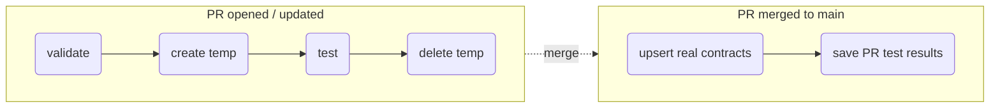

# Data Contract CI/CD — GitHub Actions Example

A ready-to-copy GitHub Actions pipeline that validates, tests, and publishes data contracts to an IBM watsonx / CPD project using the [`data-intelligence-sdk`](https://pypi.org/project/data-intelligence-sdk/).

Data contracts are stored as YAML/JSON files under `contracts/`. Every pull request that touches them is validated and tested against the platform. When the PR is merged, the real contracts are upserted and the PR's test results are attached to them.



---

## What is in this example

```
examples/github-actions/data-contracts/
├── workflows/
│   ├── data-contract.yml     # The pipeline (PR flow + merge flow)
│   └── README.md                      # Job-by-job description
├── actions/                           # Reusable composite actions
│   ├── README.md
│   ├── data-contract-validate/        # action.yml + README.md
│   ├── data-contract-create/          # action.yml + README.md
│   ├── data-contract-test/            # action.yml + README.md
│   ├── data-contract-delete/          # action.yml + README.md
│   └── data-contract-save-results/    # action.yml + README.md
└── scripts/                           # Python logic called by the actions
    ├── README.md
    ├── contract_utils.py
    ├── validate_contract.py
    ├── create_contract.py
    ├── test_contract.py
    ├── delete_contract.py
    └── save_test_results.py
```

---

## Setting up the pipeline in your own repository

### Step 1 — Copy the files

The workflow uses local actions (`uses: ./.github/actions/…`), so all three folders must land inside `.github/` of your repository.

| Copy from (this example) | Copy to (your repository) |
|---|---|
| `workflows/` | `.github/workflows/` |
| `actions/` | `.github/actions/` |
| `scripts/` | `.github/scripts/` |

```bash
# From the root of your repository
EXAMPLE=path/to/examples/github-actions/data-contracts

cp -r "$EXAMPLE/workflows/."        .github/workflows/
cp -r "$EXAMPLE/actions/."          .github/actions/
cp -r "$EXAMPLE/scripts/."          .github/scripts/
```

The final layout in **your** repository should look like this:

```
your-repo/
├── .github/
│   ├── workflows/
│   │   └── data-contract.yml
│   ├── actions/
│   │   ├── data-contract-validate/
│   │   ├── data-contract-create/
│   │   ├── data-contract-test/
│   │   ├── data-contract-delete/
│   │   └── data-contract-save-results/
│   └── scripts/
│       ├── contract_utils.py
│       ├── validate_contract.py
│       ├── create_contract.py
│       ├── test_contract.py
│       ├── delete_contract.py
│       └── save_test_results.py
├── contracts/                       # YOUR data contract files go here
│   ├── my_contract.yaml
│   └── another_contract.json
└── README.md
```

### Step 2 — Add your contract files

Create a `contracts/` folder at the root of your repository and add your data contract files (YAML or JSON in [ODCS](https://bitol-io.github.io/open-data-contract-standard/) format).

Each contract file must declare its target project ID in `customProperties`. The contract's file name (without extension) becomes its name on the platform (e.g. `contracts/sales_orders.yaml` is published as `sales_orders`).

**Standard (project) contract**

```yaml
# contracts/my_contract.yaml
customProperties:
  - property: projectId
    value: <your-cpd-project-id>
```

**DPH catalog contract** — set `isDPH: true` to route the merge-mode upsert to the Data Product Hub catalog instead of the project. The PR validation flow always uses the project regardless.

```yaml
customProperties:
  - property: projectId
    value: <your-cpd-project-id>      # required for PR validation
  - property: isDPH
    value: "true"
  - property: type
    value: contract                   # "contract" or "contract_template"
  - property: draftId
    value: <asset-uuid>@<catalog-uuid> # required when type=contract
  - property: catalogId
    value: <catalog-uuid>             # optional; resolved automatically when absent
```

| `customProperties` key | Required | Description |
|---|---|---|
| `projectId` | Always | Target project for PR validation and non-DPH merge upsert |
| `isDPH` | No | Set to `"true"` to route merge upsert to the DPH catalog |
| `type` | No | `contract` (linked to a draft) or `contract_template`. Defaults to `contract_template` |
| `draftId` | When `isDPH=true` and `type=contract` | Draft asset ID in `<asset_uuid>@<catalog_uuid>` format |
| `catalogId` | No | DPH catalog ID. When absent, resolved automatically via the DPH API |

### Step 3 — Check the trigger branch

The merge flow in `data-contract.yml` runs on pushes to `main`. If your default branch has a different name, update the `branches` list:

```yaml
push:
  branches:
    - your-default-branch   # change from 'main' if needed
  paths:
    - 'contracts/**'
```

### Step 4 — Add repository secrets

Go to **Settings → Secrets and variables → Actions → New repository secret** and add the secrets below.

| Secret | Required | Description |
|---|---|---|
| `PLATFORM_URL` | Yes | Base URL of the CPD / watsonx instance, without a trailing slash (e.g. `https://cpd.example.com`). |
| `PLATFORM_API_KEY` | Yes | IBM Cloud IAM API key. The scripts exchange it for a short-lived bearer token. The identity behind the key must have access to the target project with permission to create, replace, test, and delete data contracts. |
| `IAM_TOKEN_URL` | No | IAM token endpoint matching the environment of `PLATFORM_API_KEY`. When not set, `https://iam.test.cloud.ibm.com/identity/token` (IBM Cloud test) is used. Use `https://iam.cloud.ibm.com/identity/token` for IBM Cloud production. |

> `GITHUB_TOKEN` is provided automatically by GitHub Actions — do **not** create it manually.

### Step 5 — Allow workflow permissions

Under **Settings → Actions → General → Workflow permissions**, ensure the default permission level allows workflows to run. The workflow declares exactly the permissions it needs:

```yaml
permissions:
  pull-requests: write   # post PR comments
  contents: read         # checkout the repository
  actions: read          # download the PR's test-result artifact on merge
```

### Step 6 — Open a pull request

Create a branch, add or modify a file under `contracts/`, and open a pull request. The pipeline runs automatically and posts a comment after each stage (validate, create, test, delete).

---

## How the pipeline works

### PR flow

When a pull request adds or modifies any file under `contracts/`, four jobs run in sequence:

| Job | What it does |
|---|---|
| `validate` | Validates each changed contract file against the platform API. Fails fast — subsequent jobs are skipped if any contract is invalid. |
| `create-temp-contract` | Creates an ephemeral copy of each contract named `<filename>_PR_<pr_number>` in the target project. The real production contract is never touched at this stage. |
| `test` | Triggers a test run against each ephemeral contract, polls until completion, and reports per-rule results. Uploads each result as a JSON workflow artifact. |
| `delete-temp-contract` | Runs with `if: always()` — deletes all ephemeral contracts even if the test job failed. |

### Merge flow

After a PR is merged to `main`, one job runs (`upsert-on-merge`) with two steps:

1. **Upsert real contracts** — detects files changed since the last remote commit and upserts each one using its canonical name (filename without extension). Non-DPH contracts are upserted in the project; DPH contracts (`isDPH=true`) are upserted in the catalog and linked to their draft.
2. **Save PR test results** — downloads the JSON test results uploaded by the merged PR's test job and saves each one to the matching real contract (project or catalog). Contracts with no saved result are skipped.

No PR comment is posted on merge — results are visible in the Actions run log.

---

## Secrets reference

| Secret | Consumed by | Passed as |
|---|---|---|
| `PLATFORM_URL` | All five actions | `url` input → `PLATFORM_URL` env var |
| `PLATFORM_API_KEY` | All five actions | `api-key` input → `PLATFORM_API_KEY` env var |
| `IAM_TOKEN_URL` | All five actions | `iam-url` input → `IAM_TOKEN_URL` env var |
| `GITHUB_TOKEN` | All five actions | `github-token` input → `GH_TOKEN` env var for the `gh` CLI |

---

## Local debugging

The Python scripts can be run outside GitHub Actions. Install the SDK and set the required environment variables, then invoke any script directly.

```bash
pip install data-intelligence-sdk

export PLATFORM_URL="https://cpd.example.com"
export PLATFORM_API_KEY="your-iam-api-key"
export IAM_TOKEN_URL="https://iam.cloud.ibm.com/identity/token"   # optional

# Validate a single contract
python .github/scripts/validate_contract.py contracts/my_contract.yaml

# Create a temp contract for PR 42
python .github/scripts/create_contract.py --mode pr --pr-number 42 contracts/my_contract.yaml

# Upsert the real contract after merge
python .github/scripts/create_contract.py --mode merge contracts/my_contract.yaml
```

See [`scripts/README.md`](scripts/README.md) for the full argument reference for each script.

---

## Security notes

- Never commit the API key or URL. Keep them as Actions secrets only.
- **Pull requests from forks do not receive repository secrets**, so the pipeline cannot reach the platform for fork PRs. For a public repository, have contributors open PRs from branches within the same repository, or review fork PRs and re-run them from a branch you control.
- Use a dedicated service-ID API key with the minimum project access required.
- The PR flow creates and deletes temporary contracts (`<name>_PR_<number>`) in the target project. Point it at a non-production project when possible.

---

## Known items to review when reusing

- **SDK version.** Every `action.yml` installs a pinned version of `data-intelligence-sdk`. Check [`actions/README.md`](actions/README.md) for how to update the version string across all actions.
- **IAM endpoint.** Set the optional `IAM_TOKEN_URL` secret to the token endpoint matching your API key's environment. No code change is needed.
- **Trigger paths.** The PR flow also re-runs when `.github/workflows/`, `.github/actions/`, or `.github/scripts/` change. Adjust the `paths` filter in `data-contract.yml` if that is not desirable.

---

## Documentation index

| Topic | Location |
|---|---|
| Pipeline jobs, conditions, and changed-file detection | [`workflows/README.md`](workflows/README.md) |
| Composite actions and their inputs/outputs | [`actions/README.md`](actions/README.md) |
| Python scripts and local usage | [`scripts/README.md`](scripts/README.md) |
