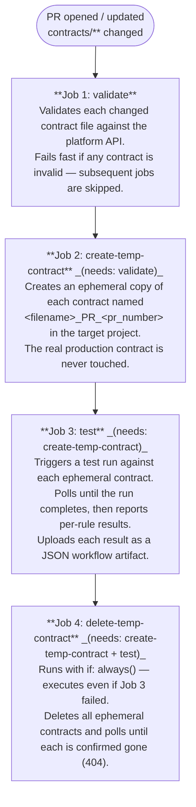

# CI/CD Workflow

The pipeline is defined in [`data-contract.yml`](data-contract.yml) and triggers on two events:

| Event | Paths watched | What runs |
|---|---|---|
| `pull_request` | `contracts/**`, `.github/workflows/**`, `.github/actions/**`, `.github/scripts/**` | PR flow (validate → create → test → delete) |
| `push` to `main` | `contracts/**` | Merge flow (upsert real contracts, then save test results) |

---

## PR Flow

When a pull request adds or modifies any file under `contracts/`, four jobs run in sequence. A PR comment is posted after each job so reviewers have full visibility without leaving GitHub.



### Job conditions

| Job | Condition |
|---|---|
| `validate` | `github.event_name == 'pull_request'` |
| `create-temp-contract` | PR event **and** at least one contract file changed |
| `test` | PR event **and** `create-temp-contract` produced contract IDs |
| `delete-temp-contract` | `always()` **and** PR event **and** contract IDs exist |

---

## Merge Flow

After a PR is merged to `main`, a single job runs:

**`upsert-on-merge`** — runs two steps:

1. **Upsert real contracts** — detects files changed since the last remote commit, then calls the [create action](../actions/data-contract-create/README.md) in `merge` mode. This upserts each changed contract using its canonical name (the filename without extension). If a contract with that name already exists in the project it is replaced; otherwise it is created fresh.
2. **Save PR test results** — calls the [save-results action](../actions/data-contract-save-results/README.md), which downloads the JSON test results uploaded by the merged PR's test job and saves each one to the matching real contract with `POST /test_results`. Contracts with no saved result are skipped.

The save-results action then comments on the merged PR with the created/updated contracts (and their IDs) and the saved test result IDs.

---

## Required Secrets

Configure these in **Settings → Secrets and variables → Actions**:

| Secret | Description |
|---|---|
| `PLATFORM_URL` | Base URL of the CPD / watsonx instance (e.g. `https://api.dai.dev.cloud.ibm.com`) |
| `PLATFORM_ENV` | *(Optional)* `ibm_cloud` (default), `aws_cloud`, `gov_cloud` or `on_prem` |
| `PLATFORM_API_KEY` | API key with access to the target project. Required for cloud environments; for `on_prem` use it or `PLATFORM_USERNAME` + `PLATFORM_PASSWORD` |
| `PLATFORM_USERNAME` | *(`on_prem` only)* Username |
| `PLATFORM_PASSWORD` | *(`on_prem` only)* Password, when no API key is used |
| `PLATFORM_ACCOUNT_ID` | *(`aws_cloud` only)* Account ID |
| `IAM_TOKEN_URL` | *(Optional, cloud only)* IAM token endpoint matching the environment the API key belongs to, e.g. `https://iam.cloud.ibm.com/identity/token`. If unset, the IBM Cloud test endpoint `https://iam.test.cloud.ibm.com/identity/token` is used |

`GITHUB_TOKEN` is provided automatically by GitHub Actions — no manual configuration needed.

> **On-prem:** the jobs use `runs-on: ubuntu-latest` (GitHub-hosted), which cannot reach a private Cloud Pak for Data instance. Switch the jobs to a self-hosted runner or connect through a VPN first — see [On-prem network access](../README.md#on-prem-network-access).

---

## Workflow Permissions

```yaml
permissions:
  pull-requests: write   # post PR comments
  contents: read         # checkout the repository
  actions: read          # download the PR's test-result artifact on merge
```

---

## Changed-file Detection

Both flows use [`tj-actions/changed-files@v44`](https://github.com/tj-actions/changed-files) to detect which files under `contracts/**` were modified. Only changed files are processed — unchanged contracts are skipped entirely.
